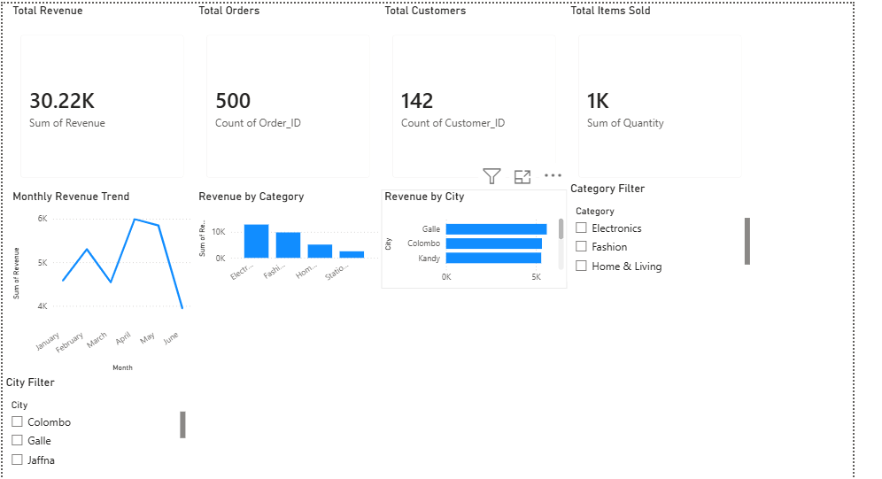

# 📊 E-Commerce Sales Analytics

An end-to-end data analytics project that analyzes e-commerce sales data using Python, SQL, and Power BI to uncover business insights, sales trends, customer behavior, and regional performance.

## 🎯 Project Objective

The objective of this project is to transform raw e-commerce sales data into meaningful business insights through data cleaning, exploratory data analysis, SQL analysis, and interactive dashboard development.

## 🛠️ Technologies Used

- Python
- Pandas
- Matplotlib
- SQL
- SQLite
- Power BI
- Jupyter Notebook
- Git & GitHub

## 🔄 Project Workflow

Raw Sales Data  
↓  
Data Cleaning with Python  
↓  
Exploratory Data Analysis  
↓  
SQL Business Analysis  
↓  
Power BI Dashboard  
↓  
Business Insights


## 📊 Power BI Dashboard

The interactive Power BI dashboard includes:

- Total Revenue
- Total Orders
- Total Customers
- Total Items Sold
- Monthly Revenue Trend
- Revenue by Category
- Revenue by City
- Category Filter
- City Filter



## 📁 Project Structure

```text
ecommerce-sales-analytics/
│
├── data/
│   ├── ecommerce_sales_raw.csv
│   └── ecommerce_sales_cleaned.csv
│
├── notebooks/
│   ├── 01_data_cleaning.ipynb
│   ├── 02_exploratory_data_analysis.ipynb
│   └── 03_sql_analysis.ipynb
│
├── sql/
│   └── analysis_queries.sql
│
├── dashboard/
│   └── ecommerce_sales_dashboard.pbix
│
├── images/
│   └── dashboard_preview.png
│
├── README.md
├── requirements.txt
└── .gitignore